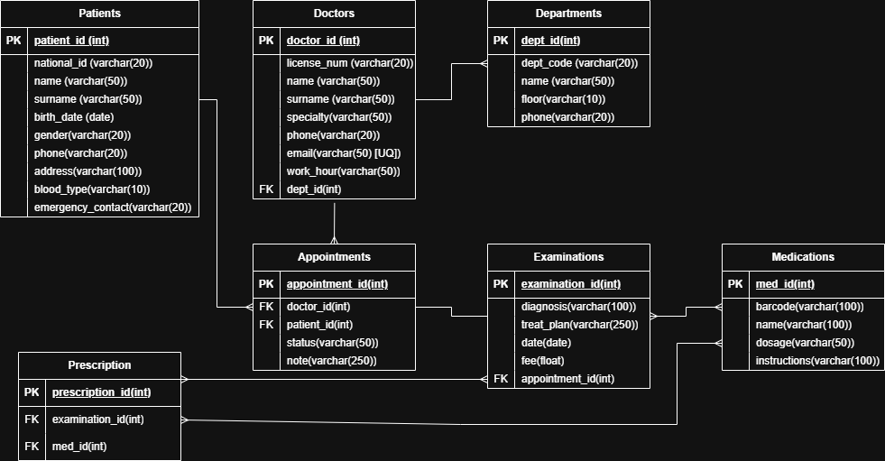
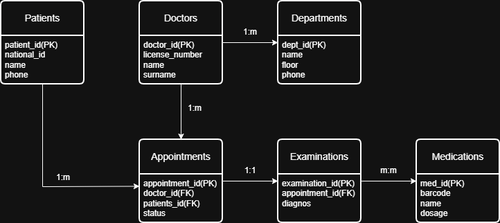

# Hospital Management System — Relational Database Architecture (PostgreSQL)


A normalized (**3NF**) relational database schema and Entity-Relationship model engineered in **PostgreSQL** for clinical and administrative hospital operations—managing departments, physicians, patient registries, appointment workflows, clinical examinations, and multi-medication prescriptions.

---

## Entity-Relationship Diagrams (ERD)

### Logical Relational Schema (Tables, Data Types & PK/FK Cardinalities)


### Conceptual Domain Model


---

## Schema Architecture & Integrity Constraints (`schema.sql`)

| Table | Primary Key | Unique / Check Constraints & Foreign Keys | Domain Purpose |
| :--- | :--- | :--- | :--- |
| **`Departments`** | `dept_id` (`SERIAL`) | `dept_code VARCHAR(20) NOT NULL UNIQUE` | Hospital clinical units, floor locations, and contact lines |
| **`Patients`** | `patient_id` (`SERIAL`) | `national_id VARCHAR(20) NOT NULL UNIQUE` | Patient demographics, blood type, and emergency contacts |
| **`Doctors`** | `doctor_id` (`SERIAL`) | `license_num UNIQUE`, `email UNIQUE`, `FK -> Departments(dept_id)` | Physician credentials, specialties, shift hours, and department assignment |
| **`Appointments`** | `appointment_id` (`SERIAL`) | `CHECK (status IN ('Scheduled', 'Completed', 'Cancelled'))`, `FK -> Doctors`, `FK -> Patients` | Scheduled patient-doctor consultations and status tracking |
| **`Examinations`** | `examination_id` (`SERIAL`) | `appointment_id INT NOT NULL UNIQUE` (`1:1 FK -> Appointments`) | Clinical diagnosis, treatment plan, and consultation fee per completed visit |
| **`Medications`** | `med_id` (`SERIAL`) | `barcode VARCHAR(100) UNIQUE` | Pharmaceutical catalog with standard dosage and administration instructions |
| **`Prescriptions`** | `prescription_id` (`SERIAL`) | `FK -> Examinations(examination_id)`, `FK -> Medications(med_id)` | Associative (`M:N`) bridge resolving multiple prescribed medications per examination |

### Performance Indexing Strategy
To accelerate high-frequency clinical lookups, three targeted B-Tree indexes are provisioned:
- `idx_patients_national_id ON Patients(national_id)` — Instant patient intake lookup by government ID.
- `idx_appointments_date ON Appointments(date)` — Range-scan optimization for daily physician schedule views.
- `idx_doctors_surname ON Doctors(surname)` — Fast directory search by physician last name.

---

## Quick Start

```bash
# Execute DDL, indexes, and seed data in PostgreSQL
psql -U postgres -d hospital_db -f schema.sql
```
